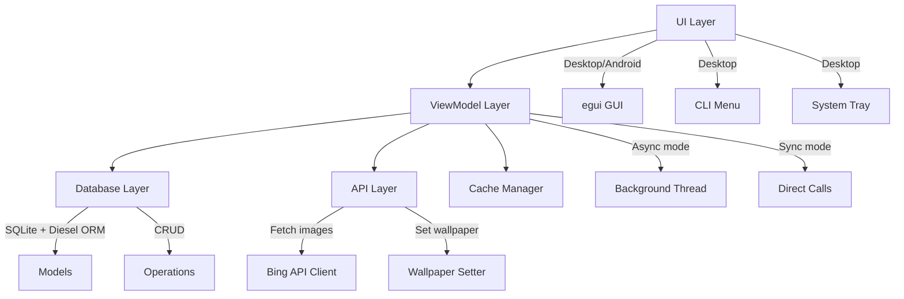
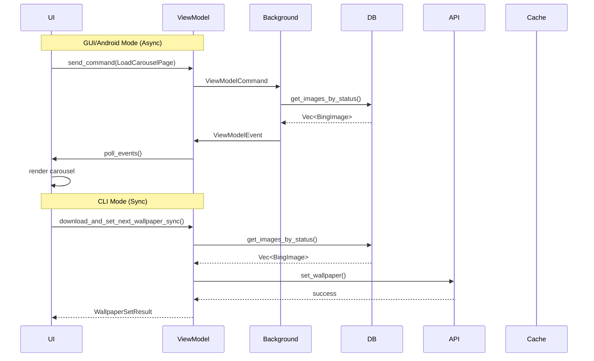

# BingTray Architecture

Cross-platform Bing wallpaper manager (Desktop + Android + CLI)

## System Overview

## Core Layers

### Database Layer
interface DatabaseLayer {
  path {
    Desktop: "~/.config/bingtray/bingtray.db"
    Android: "/data/data/pe.nikescar.bingtray/files/bingtray.db"
  }
  
  ORM: "Diesel SQLite"
  
  Models {
    BingImage {
      id: i32
      url: String
      title: String
      copyright: Option<String>
      copyright_link: Option<String>
      market_code: String
      fetched_at: i32 (Unix timestamp)
      status: "unprocessed" | "keepfavorite" | "blacklisted"
      created_at: i32
      updated_at: i32
      cached_at: Option<i32>
      crop_coords: Option<String> (JSON serialized CropCoords)
    }
    
    MarketCode {
      id: i32
      code: String (e.g., "en-US", "ja-JP")
      last_used_at: i32
      created_at: i32
      updated_at: i32
    }
    
    ConfigKv {
      id: i32
      key: String
      value: String
      created_at: i32
      updated_at: i32
    }
  }
  
  Operations {
    fn get_image(conn, url) -> Option<BingImage>
    fn get_images_by_status(conn, status) -> Vec<BingImage>
    fn get_images_by_market(conn, market_code, page) -> Vec<BingImage>
    fn update_image_status(conn, url, status)
    fn insert_image(conn, NewBingImage)
    fn get_config_value(conn, key) -> Option<String>
    fn set_config_value(conn, key, value)
  }
  
  Migrations: "Embedded diesel migrations"
  
  constraint {
    WAL mode enabled for concurrent access
    Busy timeout: 30 seconds
    Migrations run on first connection
  }
}

### ViewModel Layer (MVVM Pattern)
interface ViewModelLayer {
  Architecture: "MVVM - Model-View-ViewModel"
  
  Threading {
    AsyncMode {
      use_case: ["GUI", "Android", "Tray"]
      pattern: "Background thread with message passing"
      channels: "std::sync::mpsc for UI communication"
      runtime: "asupersync (structured concurrency)"
      constraint: Non-blocking UI during I/O operations
    }
    
    SyncMode {
      use_case: "CLI"
      pattern: "Direct function calls"
      channels: None
      constraint: Blocking operations acceptable for CLI
    }
  }
  
  MessageTypes {
    ViewModelCommand (UI → Background) {
      DownloadImages { market_code }
      SetWallpaper { url }
      ToggleFavorite { url }
      BlacklistImage { url }
      UnmarkImage { url }
      GetImagesByStatus { status }
      GetImagesByMarket { market_code, page }
      RefreshDatabase
      LoadCarouselPage { filter, page }
      LoadMainImage { url }
      UpdateCropCoords { url, coords }
      Shutdown
    }
    
    ViewModelEvent (Background → UI) {
      DownloadProgress { current, total }
      DownloadComplete { count }
      ImagesLoaded { images }
      WallpaperSet { success }
      StatusUpdated { url, status }
      Error { message }
      CarouselPageLoaded { page, images, total_count }
      MainImageLoaded { url, image_bytes, cached }
      MainImageRefreshed { url, image_bytes }
      CropCoordsSaved { url }
    }
  }
  
  CacheManager {
    cache_dir {
      Desktop: "~/.config/bingtray/cache/images"
      Android: "/data/data/pe.nikescar.bingtray/cache/images"
    }
    
    operations {
      fn populate_historical_images_sync()
      fn cache_initial_images() (3 images for wallpaper)
      fn get_cached_image(url) -> Option<Vec<u8>>
      fn download_and_cache(url) -> Result<Vec<u8>>
    }
    
    constraint: Historical data populated BEFORE UI loads
  }
  
  Sources {
    ImageSource {
      primary: "Bing API (7 latest images)"
      fallback: "GitHub historical archive"
    }
  }
}

### UI Layer
interface UILayer {
  Platforms {
    Desktop {
      framework: "eframe + egui"
      entry_point: "mobile/src/main.rs"
      modes: ["GUI window", "Tray icon"]
      features {
        carousel: "20 images per page with filters"
        main_panel: "Selected image with crop controls"
        filters: ["All", "Favorites", "Blacklisted", "Unprocessed"]
        actions: ["Set wallpaper", "Toggle favorite", "Blacklist"]
      }
    }
    
    Android {
      framework: "Native activity + egui"
      entry_point: "mobile/src/main_android.rs"
      features: Same as Desktop GUI
    }
    
    CLI {
      framework: "Terminal menu system"
      entry_point: "mobile/src/cli.rs"
      features: ["Download next", "Keep current", "Blacklist current", "Random favorite"]
      constraint: ViewModel runs in sync mode (no background thread)
    }
    
    Tray {
      framework: "GTK (primary) + XEmbed (fallback)"
      entry_point: "mobile/src/tray.rs"
      features: "Context menu with same actions as CLI"
      backends {
        GTK: "tray-icon crate with libayatana-appindicator3"
        XEmbed: "x11rb for minimal X11 systems"
        fallback: "GTK → XEmbed at runtime"
      }
    }
  }
  
  Theming {
    framework: "egui_material3"
    modes: ["Light", "Dark", "Auto"]
    constraint: Theme follows system preference
  }
  
  Internationalization {
    system: "egui_i18n"
    languages: ["English", "Korean", "Japanese", "More planned"]
  }
}

### API Layer
interface APILayer {
  BingImageAPI {
    endpoint: "https://www.bing.com/HPImageArchive.aspx"
    params {
      format: "js"
      idx: "0-6" (days offset)
      n: "7" (number of images)
      mkt: market_code (e.g., "en-US")
    }
    
    operations {
      fn fetch_images(market_code) -> Result<Vec<BingImage>>
      fn parse_response(json) -> Result<BingResponse>
    }
    
    constraint: Returns 7 most recent wallpapers
  }
  
  WallpaperSetterAPI {
    Desktop {
      Linux: "wallpaper crate + user mismatch detection"
      Windows: "wallpaper crate"
      macOS: "wallpaper crate"
    }
    
    Android {
      method: "JNI → WallpaperManager.setBitmap()"
      constraint: Requires WRITE_EXTERNAL_STORAGE permission
    }
    
    operations {
      fn set_wallpaper_from_bytes(bytes) -> Result<bool>
      fn get_current_wallpaper_path() -> Option<PathBuf> (Desktop only)
    }
  }
  
  HistoricalArchive {
    source: "GitHub historical image JSON"
    fallback: "Used when Bing API fails or historical data needed"
  }
}

## Entry Points

Runtime: "Single binary, mode selected at runtime"

EntryPoint {
  mode_selection {
    if (terminal_detected) {
      run(CLI)
      ViewModel: sync_mode
    } else if (flag == "--gui") {
      run(GUI)
      ViewModel: async_mode
    } else if (flag == "--tray" || no_terminal) {
      run(Tray)
      ViewModel: async_mode
    }
  }
  
  Desktop {
    binary: "bingtray"
    builds: ["dev", "dev-release", "release"]
    features: ["GUI", "Tray", "CLI"]
  }
  
  Android {
    build: "gradle + cargo apk"
    activity: "NativeActivity + egui"
    features: ["GUI only"]
  }
}

## Data Flow

## Image Processing

ImageProcessing {
  CropCoords {
    format: "Normalized 0.0-1.0 relative to image dimensions"
    fields {
      x: f32 (left edge)
      y: f32 (top edge)
      width: f32 (width)
      height: f32 (height)
    }
    
    constraint {
      x, y, width, height ∈ [0.0, 1.0]
      width ≥ 0.01 (minimum 1% width)
      height ≥ 0.01 (minimum 1% height)
    }
    
    storage: "JSON string in database (crop_coords column)"
  }
  
  ResolutionCalculation {
    input: "Screen size from ScreenSizeProvider"
    output: "1920x1080 (default) or screen-specific resolution"
    constraint: "URL constructed with resolution params"
  }
  
  Caching {
    strategy: "Cache 3 images on startup for wallpaper"
    path: "$cache_dir/images/{filename}"
    constraint: "Historical images populated BEFORE UI loads"
  }
}

## Configuration

Config {
  paths {
    config_dir {
      Desktop: "~/.config/bingtray" (Linux)
      Desktop: "%APPDATA%\\bingtray" (Windows)
      Desktop: "~/Library/Application Support/bingtray" (macOS)
      Android: "/data/data/pe.nikescar.bingtray/files"
    }
    
    cache_dir {
      Desktop: "~/.cache/bingtray" (Linux)
      Android: "/data/data/pe.nikescar.bingtray/cache"
    }
    
    directories {
      unprocessed: "$cache_dir/unprocessed"
      keepfavorite: "$cache_dir/keepfavorite"
      cached: "$cache_dir/cached"
      image_cache: "$cache_dir/image_cache"
    }
  }
  
  settings {
    language: "Auto" | "English" | "Korean" | "Japanese"
    theme_mode: "Auto" | "Light" | "Dark"
    theme_name: "default"
    display_size: "Desktop (1024x768)"
    log_level: "Error" | "Warn" | "Info" | "Debug" | "Trace"
    show_logs: bool
  }
}

## Dependencies

CoreDependencies {
  async_runtime: "asupersync (structured concurrency)"
  gui: "eframe + egui"
  orm: "diesel + diesel_migrations"
  error_handling: "anyhow"
  serialization: "serde + serde_json"
  image_processing: "image crate"
  http: "ehttp + ehttp_cache"
  i18n: "egui_i18n"
  
  platform_specific {
    Desktop {
      tray: "tray-icon (GTK backend)"
      xembed_fallback: "x11rb"
      wallpaper: "wallpaper crate"
      trash: "trash crate"
    }
    
    Android {
      jni: "jni crate"
      activity: "android-activity"
      ndk: "ndk-context"
    }
  }
}

## Testing Strategy

TestingLayers {
  unit_tests {
    location: "mobile/tests/"
    coverage {
      db_tests: "Database CRUD, pagination, SQL injection protection"
      viewmodel_tests: "Message passing, async vs sync modes"
    }
    
    constraint: "80% minimum coverage required"
  }
  
  integration_tests {
    location: "mobile/tests/integration_tests.rs"
    coverage {
      entry_points: "Desktop init, CLI sync mode, Android activity"
      persistence: "Database persistence across restarts"
    }
  }
  
  run_command: "cargo test --manifest-path mobile/Cargo.toml"
}

## Constraints

ApplicationConstraints {
  performance {
    * UI remains responsive during downloads (async mode only)
    * Historical data loads synchronously before UI renders
    * Cache manager populates 3 images in background
  }
  
  reliability {
    * Database migrations embedded and auto-run
    * WAL mode prevents SQLite lock contention
    * Fallback tray backend (GTK → XEmbed) for compatibility
  }
  
  platform_compatibility {
    * Single binary supports GUI + Tray + CLI modes
    * Runtime mode detection (terminal, flags, default)
    * Platform-specific paths via conditional compilation
  }
  
  user_experience {
    * Carousel filters: All, Favorites, Blacklisted, Unprocessed
    * 20 images per page with pagination
    * Crop controls for custom wallpaper regions
    * System theme follows OS preference
  }
}

## Recent Architectural Changes

ArchitecturalHistory {
  "2026-06-16" {
    change: "XEmbed Tray Fallback"
    impact: "Tray icon works on minimal X11 systems without GTK"
    implementation: "Trait-based backend abstraction with runtime fallback"
    
    constraint {
      * Primary: GTK backend via tray-icon
      * Fallback: XEmbed protocol via x11rb
      * Clear error messages when both fail
    }
  }
  
  "2026-06-12" {
    change: "Diesel SQLite + MVVM Implementation"
    impact: "Migrated from DataFusion/Parquet to Diesel/SQLite"
    removed: "1,323 lines of DataFusion code"
    
    benefits {
      * Standard SQL patterns
      * Clear UI/business logic separation
      * Non-blocking UI during downloads
      * Easier to test and maintain
    }
    
    architecture {
      * Database → ViewModel → UI separation
      * Conditional threading (async GUI, sync CLI)
      * Message-based communication (Command/Event pattern)
    }
  }
}

## Options

Options {
  build_profiles {
    dev: "Fast incremental builds (opt-level 0)"
    dev_release: "Optimized without LTO for iteration"
    release: "Full optimization with LTO + symbol stripping"
  }
  
  runtime_modes {
    gui: "cargo run -- --gui"
    tray: "cargo run -- --tray"
    cli: "cargo run (from terminal)"
  }
}
